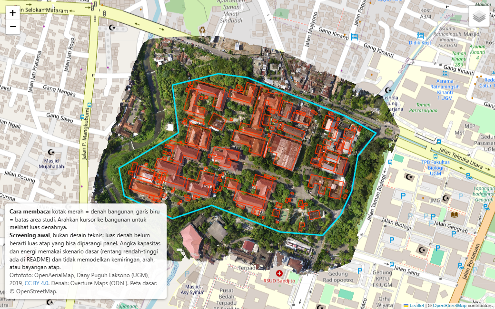

# solar-rooftop-drone

Perkiraan awal luas atap yang berpotensi dipasangi panel surya, dihitung dari **foto udara (ortofoto) hasil drone** dan data denah bangunan terbuka.

> **Status: v0.2.** Mengukur luas bangunan, lalu memperkirakan kapasitas (kWp) dan energi tahunan (kWh) dalam tiga skenario berdasarkan literatur Indonesia (lihat [Roadmap](#roadmap)).

## Lihat hasilnya

### [Buka peta interaktif](https://irwanrudy.github.io/solar-rooftop-drone/)

Tidak perlu instal apa pun, bisa dibuka di HP maupun laptop.

[](https://irwanrudy.github.io/solar-rooftop-drone/)

**Cara membaca peta:**
- Foto berwarna adalah foto udara dari drone. Di sekelilingnya adalah peta jalan biasa.
- **Kotak merah** adalah denah bangunan. Arahkan kursor (atau ketuk di HP) ke sebuah bangunan untuk melihat luas denahnya dalam meter persegi.
- **Garis biru** adalah batas area yang dipelajari.
- Tombol di pojok kanan atas bisa menyalakan atau mematikan setiap lapisan.

Peta ini menunjukkan *seberapa luas* bangunan di area tersebut, bukan *berapa banyak listrik* yang bisa dihasilkan. Baca [disclaimer](#disclaimer-baca-ini-dulu) di bawah sebelum menarik kesimpulan.

---

## Disclaimer: baca ini dulu

Project ini adalah **alat screening awal**, bukan desain teknis dan bukan dasar keputusan investasi.

Angka yang dihasilkan menjawab pertanyaan *"kira-kira seberapa besar atap di area ini?"*, bukan *"berapa panel yang bisa dipasang di atap ini?"*. Beberapa hal yang **tidak** dihitung:

- **Kemiringan dan arah atap.** Data yang dipakai hanya foto 2D, tanpa informasi ketinggian (DSM). Atap datar, miring ke utara, dan miring ke selatan diperlakukan sama, padahal hasil energinya berbeda.
- **Bayangan dan halangan.** Pohon, bangunan tetangga, tangki air, cerobong, dan antena tidak dihitung.
- **Kondisi dan kekuatan atap.** Umur material, daya dukung struktur, dan kebocoran tidak diperiksa.
- **Aturan, izin, dan sambungan listrik.** Tidak ada pengecekan terhadap regulasi, pemilik bangunan, atau jaringan PLN.
- **Luas atap sebenarnya.** Luas yang dihitung adalah luas denah bangunan (proyeksi dari atas). Atap miring punya permukaan yang lebih luas dari denahnya, dan tidak seluruh permukaan bisa dipasangi panel.

Dua sumber ketidakpastian lain yang perlu diketahui:

- **Posisi denah bangunan tidak selalu pas.** Denah dari Overture Maps berasal dari beragam sumber (antara lain OpenStreetMap dan hasil deteksi otomatis). Di beberapa bangunan, terutama yang kecil atau tertutup pohon, garis denah bisa bergeser beberapa meter dari atap sesungguhnya.
- **Cakupan data bisa bolong.** Di sebagian wilayah Indonesia, bangunan belum terpetakan atau terpetakan sebagian. Jika jumlah bangunan terlalu sedikit, script akan menampilkan peringatan.

**Tentang angka kapasitas dan energi (v0.2):**

- Angka itu **perkiraan berbasis asumsi dari literatur**, bukan hasil pengukuran atau simulasi sistem. Seluruh asumsi dan sumbernya ada di [Referensi](#referensi) dan bisa diubah di `config.yaml`.
- **Rentangnya lebar.** Pada area uji, skenario rendah dan tinggi berselisih sekitar 8 kali lipat (1,6 sampai 12,6 GWh per tahun). Penyebab terbesarnya adalah *faktor pemanfaatan atap*: fraksi denah yang benar-benar bisa dipasangi modul. Nilainya di literatur Indonesia berkisar 0,125 (atap miring perumahan di Semarang [2]) sampai 0,64 (rumah besar di Jakarta [1]).
- **Asumsi berasal dari studi perumahan di kota lain** (Jakarta [1], Semarang [2]), dengan tipologi bangunan dan atap yang berbeda dari bangunan di area uji. Belum divalidasi untuk bangunan di area ini.
- **Iradiasi dipakai pada bidang horizontal**, tanpa koreksi kemiringan dan arah modul. Studi acuan menyebut arah dan kemiringan masing-masing bisa menggeser hasil sekitar 10% dan 12% [1].
- Tidak termasuk: penurunan kinerja panel dari tahun ke tahun, biaya, tarif listrik, dan kelayakan ekonomi.

Untuk kebutuhan nyata (pemasangan, pembiayaan, atau perizinan), gunakan survei lapangan dan perhitungan oleh tenaga ahli.

---

## Tujuan

Banyak orang ingin tahu potensi surya sebuah kawasan, tapi belum punya data detail setiap atap. Project ini mencoba jalan yang ringan: memakai foto udara yang sudah ada, ditambah denah bangunan gratis, untuk mendapatkan gambaran awal dengan cepat dan bisa diulang.

Project ini juga dibuat sebagai latihan alur kerja geospasial dengan Python: membaca raster, mengolah data vektor, menangani sistem koordinat, dan menyajikan hasil di peta interaktif.

## Metodologi

1. **Baca ortofoto** (GeoTIFF): sistem koordinat (CRS), resolusi dalam meter per piksel, dan batas area. Resolusi dikoreksi untuk distorsi Web Mercator (EPSG:3857).
2. **Tentukan area analisis.** Jika ada file AOI (*area of interest*, poligon batas studi), area itu dipakai. Jika tidak ada, dipakai area ortofoto yang benar-benar berisi citra (bukan sekadar kotak pembatas).
3. **Unduh denah bangunan** dari [Overture Maps](https://overturemaps.org/) lewat DuckDB. Query memakai filter kotak batas langsung ke file Parquet di cloud, jadi hanya bagian yang relevan yang diunduh.
4. **Potong (clip) ke area analisis** dan **proyeksikan ke UTM** yang sesuai (zona dideteksi otomatis dari lokasi), supaya luas dihitung dalam meter persegi dengan akurat. Bangunan yang terpotong tepi diberi tanda `is_edge`, dan serpihan yang sangat kecil dibuang.
5. **Hitung statistik**: jumlah bangunan, total luas, serta luas minimum, median, dan maksimum.
6. **Estimasi kapasitas dan energi** (`src/solar.py`) untuk tiga skenario (rendah, dasar, tinggi), dengan rumus yang mengikuti Triana dkk. [1]:

   ```
   luas efektif   = luas denah × faktor pemanfaatan atap (UF)
   kapasitas kWp  = luas efektif × efisiensi modul × 1 kW/m²
   energi kWh/thn = luas efektif × efisiensi modul × GHI tahunan × performance ratio (PR)
   ```

   GHI (iradiasi global horizontal) diambil dari PVGIS di koordinat area studi. Skenario dasar juga dihitung per bangunan dan disimpan di GeoJSON.
7. **Buat peta interaktif** (Folium): ortofoto yang sudah diperkecil sebagai lapisan dasar, lengkap dengan denah bangunan, batas AOI, serta luas, kapasitas, dan energi setiap bangunan saat diarahkan kursor.

### Contoh hasil

Pada satu area uji seluas sekitar 16,4 hektare (AOI), dengan ortofoto resolusi 7,4 cm per piksel:

| Ukuran | Nilai |
|---|---|
| Bangunan di dalam AOI | 117 |
| Total luas denah | 56.330 m² |
| Luas median per bangunan | 76 m² |
| Bangunan terbesar | 4.758 m² |

Luas denah bukan luas atap yang bisa dipasangi panel (lihat disclaimer). Estimasi energinya:

| Skenario | UF | Efisiensi | PR | Kapasitas | Energi per tahun | Yield |
|---|---|---|---|---|---|---|
| Rendah | 0,125 | 17,3% | 0,70 | 1,2 MWp | 1,6 GWh | 1.343 kWh/kWp |
| **Dasar** | **0,49** | **20,0%** | **0,75** | **5,5 MWp** | **7,9 GWh** | **1.438 kWh/kWp** |
| Tinggi | 0,64 | 22,8% | 0,80 | 8,2 MWp | 12,6 GWh | 1.534 kWh/kWp |

Sebagai pembanding, yield skenario dasar (1.438 kWh/kWp) dekat dengan hasil PVGIS di lokasi yang sama (1.449 kWh/kWp untuk modul horizontal dengan rugi sistem 14%) dan dengan angka rata-rata nasional IESR (1.534 kWh/kWp [3]). Notebook `notebooks/01_explore_footprints.ipynb` memuat analisis sensitivitas yang menunjukkan parameter mana yang paling menentukan hasil.

### Asumsi dan sumbernya

| Parameter | Rendah | Dasar | Tinggi | Sumber |
|---|---|---|---|---|
| Faktor pemanfaatan atap (UF) | 0,125 | 0,49 | 0,64 | Rendah: koefisien atap perumahan dataran rendah Semarang [2]. Dasar dan tinggi: rumah sedang/apartemen dan rumah besar di Jakarta [1]. |
| Efisiensi modul | 17,3% | 20,0% | 22,8% | Dua skenario efisiensi pada studi Jakarta [1]. Nilai dasar adalah titik tengah (interpolasi, bukan angka dari paper). |
| Performance ratio (PR) | 0,70 | 0,75 | 0,80 | Faktor derate 0,75 dengan rentang 0,6 sampai 0,8 [2]. Batas bawah 0,70 diturunkan dari yield Jakarta 1.161 sampai 1.258 kWh/kWp [1] terhadap GHI Jakarta sekitar 1.670 kWh/m² per tahun (perhitungan penulis, kasar). |
| GHI tahunan | 1.918 kWh/m² per tahun | | | PVGIS-ERA5 2005 sampai 2023 di titik area studi [4]. NASA POWER memberi 1.883, selisih sekitar 2% [5]. |

Faktor pemanfaatan pada [1] ada per tipe bangunan: 0,36 (rumah kecil), 0,49 (sedang), 0,64 (besar), 0,49 (apartemen), 0,86 (industri), dan 0,60 (komersial). Tipe bangunan dari Overture di area uji sebagian besar kosong (89 dari 117 bangunan), sehingga project ini memakai satu nilai per skenario, bukan nilai per tipe.

## Instalasi (Windows)

Diuji di Python 3.13 (Windows 11). Butuh koneksi internet (untuk mengunduh denah bangunan).

```powershell
git clone https://github.com/irwanrudy/solar-rooftop-drone.git
cd solar-rooftop-drone

python -m venv .venv
.\.venv\Scripts\Activate.ps1
pip install -r requirements.txt
```

## Cara menjalankan

1. Data contoh sudah ada di folder `data/` (ortofoto dan AOI area uji), jadi bisa langsung dijalankan. Untuk area lain, siapkan:
   - `data/orto/<nama>.tif`: ortofoto RGB berformat GeoTIFF.
   - `data/aoi/<nama>.shp`: poligon batas area studi (opsional).
2. Sesuaikan nama file di `config.yaml` (bagian `input`).
3. Jalankan:

```powershell
python src/footprints.py
```

Hasil ada di folder `output/`:

| File | Isi |
|---|---|
| `buildings.geojson` | Denah bangunan hasil clip, lengkap dengan `area_m2` |
| `buildings_summary.csv` | Jumlah bangunan, total luas, min/median/max |
| `map.html` | Peta interaktif, bisa dibuka langsung di browser |
| `docs/index.html` | Salinan `map.html` yang dipublikasikan lewat GitHub Pages (diatur oleh `output.publish_copy`) |

### Pengaturan (`config.yaml`)

| Kunci | Fungsi |
|---|---|
| `input.ortho` | Path ortofoto |
| `input.aoi` | Path AOI. Kosongkan untuk memakai area data valid ortofoto |
| `input.clip_to_valid_data` | Jika tanpa AOI: potong ke area ber-citra, bukan kotak pembatas |
| `output.*` | Folder dan nama file hasil |
| `map.overlay_max_px` | Ukuran sisi terpanjang gambar ortofoto di peta (makin kecil, makin ringan) |
| `solar.enabled` | Nyalakan/matikan estimasi energi |
| `solar.base_scenario` | Skenario yang dihitung per bangunan (masuk GeoJSON dan peta) |
| `solar.annual_ghi_kwh_m2` | GHI tahunan lokasi studi. Ganti jika area studi di tempat lain |
| `solar.scenarios.<nama>` | `utilization_factor`, `module_efficiency`, `performance_ratio` per skenario |
| `overture.release` | `latest` atau versi tertentu, mis. `2026-09-23.1` |
| `overture.min_area_m2` | Buang serpihan hasil clip di bawah luas ini |
| `overture.min_buildings_warn` | Tampilkan peringatan jika bangunan lebih sedikit dari ini |

## Struktur folder

```
solar-rooftop-drone/
├── src/footprints.py   # script utama (denah, clip, luas, peta)
├── src/solar.py        # estimasi kapasitas dan energi (fungsi murni, ada tes)
├── tests/              # pytest untuk solar.py
├── config.yaml         # semua path dan parameter
├── requirements.txt
├── requirements-dev.txt  # tambahan untuk notebook dan tes (jupyterlab, matplotlib, pytest)
├── data/               # data contoh: orto/ (ortofoto) dan aoi/ (batas area studi)
├── output/             # hasil (tidak di-commit)
└── notebooks/
    └── 01_explore_footprints.ipynb   # ringkasan, grafik, skenario energi, sensitivitas
```

Untuk membuka notebook: `pip install -r requirements-dev.txt`, jalankan `python src/footprints.py` dulu, lalu `jupyter lab`. Untuk menjalankan tes: `pytest`.

## Keterbatasan

- Tanpa DSM, semua atap dianggap datar dan menghadap langit; tidak ada analisis bayangan.
- Faktor pemanfaatan atap adalah satu nilai per skenario, bukan per tipe atau bangunan, dan berasal dari studi di kota lain (lihat disclaimer).
- GHI dipakai sebagai satu angka tahunan, tanpa pola bulanan atau transposisi ke bidang miring.
- Hasil bergantung pada kualitas dan kelengkapan data Overture di lokasi studi.
- Posisi denah bisa bergeser relatif terhadap ortofoto (lihat disclaimer). Belum ada koreksi otomatis.
- Ortofoto diasumsikan RGB. Piksel hitam murni dianggap "tidak ada data".
- Ortofoto uji berumur sekitar tujuh tahun (2019) dibanding data denah yang dipakai, sehingga perubahan bangunan sejak saat itu tidak tertangkap.
- Baru diuji pada satu area studi.

## Roadmap

- [x] **v0.1**: denah bangunan Overture, clip ke AOI, luas, peta interaktif.
- [x] **v0.2**: luas efektif dengan faktor pemanfaatan, lalu kWp dan kWh per tahun dalam tiga skenario. Parameter diatur di `config.yaml`, bersumber dari literatur Indonesia.
- [ ] **v0.3**: deteksi atap sendiri dari ortofoto memakai SAM ([segment-geospatial](https://github.com/opengeos/segment-geospatial)), lalu dibandingkan dengan Overture.
- [ ] **v0.4**: analisis kemiringan (slope) dan arah (aspect) atap jika DSM tersedia, misalnya dari WebODM.

## Referensi

Angka dan rumus pada estimasi energi (v0.2) berasal dari sumber berikut. Sumber [1] sampai [3] adalah literatur Indonesia dan dibaca langsung dari teks lengkapnya.

1. Triana, D., Garniwa, I., Rosadi, A. H., & Martono, D. N. (2024). Performance Analysis Simulation of Urban Rooftop Photovoltaic Potential in Jakarta City, Indonesia. *Environmental Research, Engineering and Management*, 80(4). [doi:10.5755/j01.erem.80.4.34200](https://doi.org/10.5755/j01.erem.80.4.34200)
   Dipakai untuk: rumus energi, faktor pemanfaatan atap per tipe bangunan, dan dua skenario efisiensi modul (17,3% dan 22,8%).
2. Widodo, D. A., Purwanto, P., & Hermawan, H. (2020). Potential of Solar Energy in Residential Rooftop Surface Area in Semarang City, Indonesia. *Advances in Science, Technology and Engineering Systems Journal*, 5(4), 397-404. [doi:10.25046/aj050446](https://doi.org/10.25046/aj050446)
   Dipakai untuk: koefisien atap 0,125 (dataran rendah) dan 0,145 (perbukitan), serta faktor derate 0,75 (rentang 0,6 sampai 0,8).
3. Tampubolon, A., Damayanti, H., Tumiwa, F., & Citraningrum, M. (2019). *Powering the Cities: Technical Potential of Rooftop Solar for Public and Commercial Buildings in Two Metropolitan Cities in Indonesia*. Technical Note, Institute for Essential Services Reform (IESR), Juli 2019. [PDF](https://iesr.or.id/wp-content/uploads/2019/07/IESR-Technical-Note-Powering-The-Cities-Technical-Potential-JKT-SBY.pdf)
   Dipakai untuk: pembanding yield nasional (1.534 kWh/kWp per tahun) dan konteks iradiasi Indonesia (rata-rata GHI 4,8 kWh/m² per hari).
4. European Commission, Joint Research Centre. *PVGIS 5.3*, basis data radiasi PVGIS-ERA5 (2005 sampai 2023). Diakses 20 Oktober 2026 untuk koordinat -7,7653, 110,3728. [re.jrc.ec.europa.eu/pvg_tools](https://re.jrc.ec.europa.eu/pvg_tools/en/)
   Dipakai untuk: GHI tahunan 1.918 kWh/m² dan pembanding yield.
5. NASA Langley Research Center. *Prediction of Worldwide Energy Resources (POWER)*, klimatologi v2.10.1, parameter `ALLSKY_SFC_SW_DWN` (5,159 kWh/m² per hari). Diakses 20 Oktober 2026. [power.larc.nasa.gov](https://power.larc.nasa.gov/)
   Dipakai untuk: pembanding GHI.

**Catatan kejujuran sumber:** nilai faktor pemanfaatan dari studi internasional (Schallenberg-Rodríguez 2013; Vardimon 2011; Horan dkk. 2020) hanya dikutip melalui [1] dan tidak dibaca langsung, sehingga tidak dijadikan parameter. Studi Indonesia lain yang sempat ditemukan (Makassar, Sihotang & Okajima 2017; Bali, tesis TU Delft 2022) tidak bisa dibuka teks lengkapnya saat penulisan, sehingga angkanya tidak dipakai. Triana dkk. [1] menulis koefisien Semarang sebagai 0,125 dan 0,15; paper aslinya [2] memuat 0,145 untuk perbukitan, dan README ini mengikuti paper aslinya.

## Sumber data dan atribusi

### Ortofoto: OpenAerialMap

| | |
|---|---|
| Judul | FT-UGM |
| Sumber | [OpenAerialMap (HOT Imagery)](https://imagery.hotosm.org/browse?lat=-7.7653&lon=110.3728&zoom=16.2&platform=uav&selected_id=5e32915d4469a3000531a76b) |
| Pengunggah / kontak | Dany Puguh Laksono (UGM) |
| Platform dan sensor | UAV (drone), DJI FC300X |
| Pemrosesan | WebODM |
| Tanggal akuisisi | 26 Februari 2019 |
| Resolusi | sekitar 7,5 cm per piksel, EPSG:3857, 3 band RGB |
| Lisensi | [CC BY 4.0](https://creativecommons.org/licenses/by/4.0/) |

Ortofoto ini dipakai sesuai lisensi CC BY 4.0 dengan mencantumkan atribusi di atas. Salinan file aslinya disertakan di `data/orto/` (sekitar 17 MB, tanpa modifikasi) agar project bisa langsung dijalankan. Sumber resminya tetap tautan di atas. Untuk area lain, pakai ortofoto lain berformat GeoTIFF RGB.

> **Catatan waktu:** ortofoto direkam tahun 2019, sedangkan denah Overture berasal dari rilis yang jauh lebih baru. Bangunan yang dibangun, dibongkar, atau diubah di antara kedua tanggal itu bisa tidak cocok dengan citra.

### Denah bangunan: Overture Maps

[Overture Maps Foundation](https://overturemaps.org/), tema *buildings*. Data ini memuat kontribusi OpenStreetMap dan dilisensikan di bawah [ODbL](https://opendatacommons.org/licenses/odbl/). Cek ketentuan lisensi sebelum memakai ulang hasilnya.

### Lainnya

- Peta dasar pada `map.html`: © kontributor [OpenStreetMap](https://www.openstreetmap.org/copyright).
- AOI (batas area studi, `data/aoi/`) dibuat sendiri oleh pembuat project.
